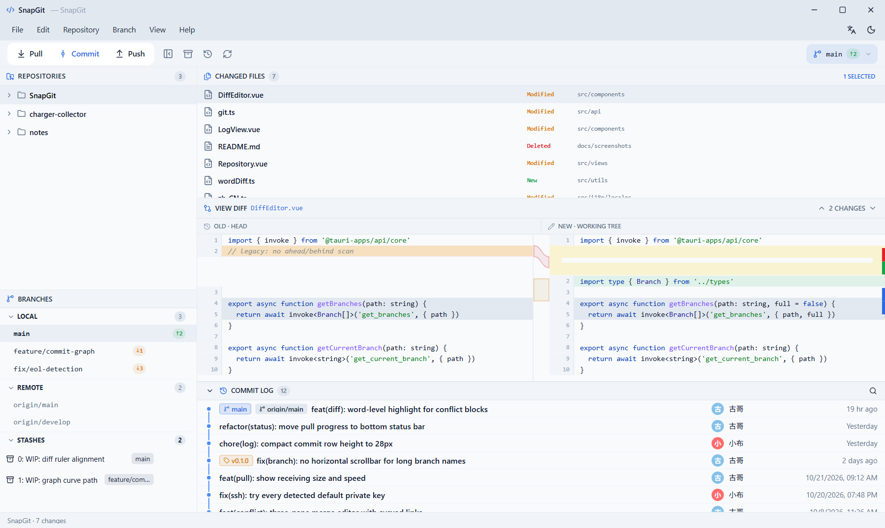
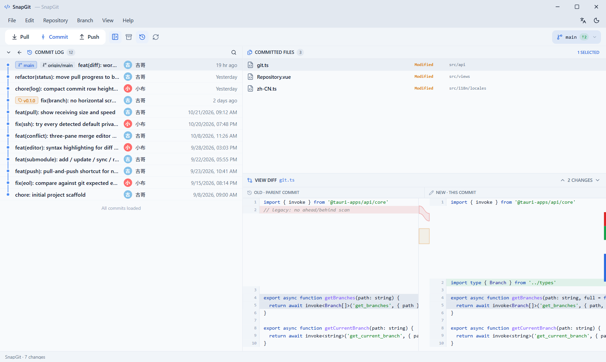
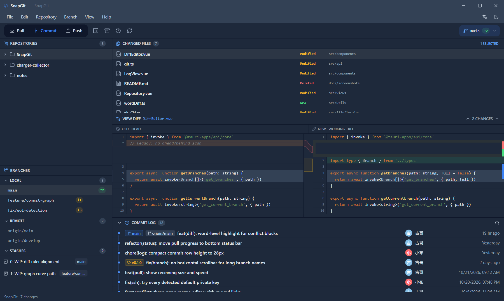

#  SnapGit

> 🚀 A lightweight, fast and stable Git desktop client, built with **Tauri 2 + Vue 3 + Rust**. Native on Windows and macOS, with light / dark themes and a bilingual (中文 / English) interface.

**[简体中文](README.zh-CN.md)** · **[⬇ Download installers](https://github.com/gusijin/SnapGit/tree/main/releases)**

[](LICENSE)
[](#download)
[](https://github.com/gusijin/SnapGit/tree/main/releases)
[](https://github.com/gusijin/SnapGit/tree/main/releases)
[](https://github.com/gusijin/SnapGit)
[](LICENSE)

**💯 100% free & open source — no activation, ever.** No account, no license key, no sign-in, no trial period, no paid tier. Download the installer, open a repository, and SnapGit is ready to use immediately.



<sub>Working tree view: repositories, branches, changed files, a two-pane diff and the commit log in one window. Screenshots use sample repository data.</sub>

## Download

Installers for **0.1.0** ship in the repository's **[releases/ directory](https://github.com/gusijin/SnapGit/tree/main/releases)** — open a file and use **Download raw file**. The standard **[GitHub Releases](https://github.com/gusijin/SnapGit/releases)** page is created automatically when a `v*` tag is pushed (see [CI](#ci)).

> ✅ All installers are free to download. There is no registration, activation step or trial period — just install it and open a repository.

| Platform | Architecture | Installer |
| --- | --- | --- |
| Windows | x64 (64-bit) | [`SnapGit_0.1.0_x64-setup.exe`](https://github.com/gusijin/SnapGit/blob/main/releases/SnapGit_0.1.0_x64-setup.exe) |
| Windows | x86 (32-bit) | [`SnapGit_0.1.0_x86-setup.exe`](https://github.com/gusijin/SnapGit/blob/main/releases/SnapGit_0.1.0_x86-setup.exe) |
| macOS | Apple Silicon (arm64) | [`SnapGit_0.1.0_aarch64.dmg`](https://github.com/gusijin/SnapGit/blob/main/releases/SnapGit_0.1.0_aarch64.dmg) |
| macOS | Intel (x86_64) | [`SnapGit_0.1.0_x64.dmg`](https://github.com/gusijin/SnapGit/blob/main/releases/SnapGit_0.1.0_x64.dmg) |

### Windows

1. Download `SnapGit_0.1.0_x64-setup.exe` — pick the `x86` build **only** on 32-bit Windows.
2. Run the NSIS installer. The WebView2 Runtime is installed automatically when missing.
3. Launch SnapGit and use **File → Open Repository**; the first-run scan also finds local repositories for you.

### Mac

1. Download the `.dmg` that matches your chip: `aarch64` for Apple Silicon, `x64` for Intel.
2. Open the DMG and drag **SnapGit** into `Applications`.
3. Builds are **ad-hoc signed but not notarized** with an Apple Developer ID. If Gatekeeper reports that the app is damaged, right-click the app and choose **Open**, or remove the quarantine flag:

   ```bash
   sudo xattr -rd com.apple.quarantine /Applications/SnapGit.app
   ```

   Distributing to other Macs requires a Developer ID signature and notarization — see [Dev Build](#dev-build).

> Prefer to build it yourself? Jump to [Dev Build](#dev-build).

## User Interface

| # | Area | What it does |
| --- | --- | --- |
| ① | **Menu bar & toolbar** | File / Edit / Repository / Branch / View / Help, plus one-click Pull, Commit, Push, refresh, branch switch and the `↑N ↓N` ahead/behind indicator. On macOS the menu lives in the system menu bar. |
| ② | **Left sidebar** | Repository list (collapsible), local / remote branches with ahead-behind badges, stashes, and an optional Submodules panel. Panel splitters are draggable and their positions are remembered. |
| ③ | **Working tree** | Changed files on top, a two-pane diff in the middle (red deletions / green additions, syntax highlighting, a minimap ruler and curved hunk connectors), and the commit log at the bottom. |
| ④ | **History view** | Full commit graph with branch / tag chips, per-commit file list and a diff for the selected commit. |
| ⑤ | **Status bar** | Always visible at the bottom, across views: `repository · working tree summary`, live pull progress (`Receiving objects · 34% · 1.2 MiB · 300 KiB/s`), or a red unresolved-conflict warning. |

**History view** — click a commit to inspect its files and diff:



**Dark theme** — switch from **View → Toggle Theme** (or the toolbar icon); preference is saved:



The **Submodules panel is hidden by default**. Enable it from **View → Submodules**; the choice is persisted and restored on the next launch.

## Features

- **Free & activation-free** — open source under Apache-2.0; no account, no license key, no trial, no paid tier. Every feature works right after installation.
- **Repositories** — open, clone, initialize and scan local repos; recent-repository list and cached first-run scan for a fast start.
- **Branches** — create, checkout, rename, merge, delete local / remote branches; ahead / behind counts; detached-HEAD awareness.
- **Commits & sync** — stage files, commit, commit-and-push, pull with merge / rebase strategy, non-fast-forward recovery with **Pull and Push**, push failure classification (credentials / SSH / non-ff), automatic fallback across all detected SSH private keys.
- **Diff viewer** — two-pane line-level diff with syntax highlighting, word-level changes, EOL mismatch hints, binary-file protection and a 5000-line cap for huge files; an editable diff window for quick fixes.
- **Conflict resolution** — a three-pane merge editor (ours / working / theirs) with curved connectors, plus explicit finish-merge / continue-rebase / abort actions. Committing is blocked until conflicts are resolved.
- **Submodules** — list, add, update, sync and remove, with initialization / pointer-change / dirty status.
- **Stashes** — create, apply and drop.
- **Experience** — light / dark theme, 中文 / English UI, bottom status bar, live pull progress, draggable panels, conflict guards and staged loading that keeps the first screen responsive on large repositories.
- **Cross-platform** — Windows x64 / x86 and macOS Apple Silicon / Intel from a single codebase (WebView2 on Windows, WKWebView on macOS).

## Dev Build

### Requirements

- Node.js 18+, Rust 1.70+, Git
- Windows: Visual Studio Build Tools (MSVC + WebView2)
- macOS: Xcode Command Line Tools

```bash
npm install
npm run tauri dev      # start the app in development mode
npm run build          # type-check + build the frontend only
```

### Packaging

```bash
# Windows (NSIS installer, x64 by default)
npm run tauri -- build --bundles nsis

# Windows 32-bit (add the target once)
rustup target add i686-pc-windows-msvc
npm run tauri -- build --target i686-pc-windows-msvc --bundles nsis

# macOS (must run on a Mac; Apple disallows cross-compiling macOS bundles)
npm run tauri -- build --bundles dmg
```

Output lands in `src-tauri/target/release/bundle/` (or `src-tauri/target/<triple>/release/bundle/` when `--target` is used). macOS builds are ad-hoc signed by default; use a Developer ID in `bundle.macOS.signingIdentity` and notarize before distributing.

### CI

`.github/workflows/release.yml` builds all four installers with three jobs (Windows x64 + x86, macOS arm64 + x86_64, collect). Push a `v*` tag to publish a GitHub Release, or run the workflow manually:

```bash
git tag v0.1.0
git push origin v0.1.0
```

A manual `workflow_dispatch` run only rebuilds and commits the artifacts into `releases/` — it does **not** create a GitHub Release.

## FAQ

**Is SnapGit free? Do I need to activate it?** Yes — SnapGit is 100% free and open source (Apache-2.0). There is no account, serial number, activation step, trial period or paid tier; all features are usable immediately after installation.

**The macOS app says it is damaged / cannot be opened.** The build is not notarized — see the [Mac](#mac) section for the `xattr` command.

**Where is the Submodules panel?** Hidden by default. **View → Submodules** toggles it, and the setting is remembered across restarts.

**Why does a file show as modified when its content looks unchanged?** SnapGit compares the file with the EOL format Git expects (`core.autocrlf` / `core.eol`), not with the HEAD blob; check the EOL hint in the diff header.

## License

[Apache License 2.0](LICENSE).
