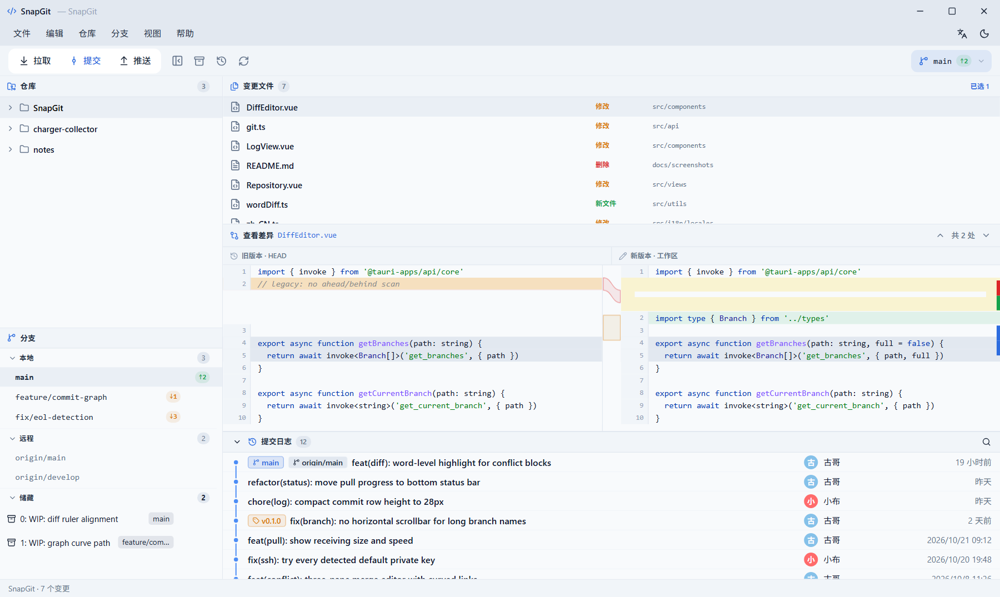
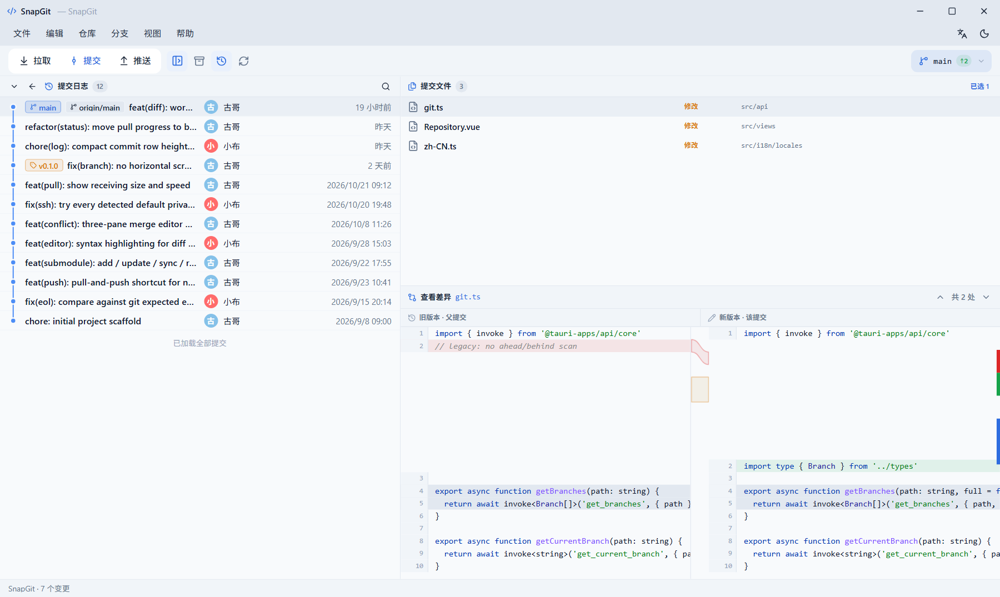
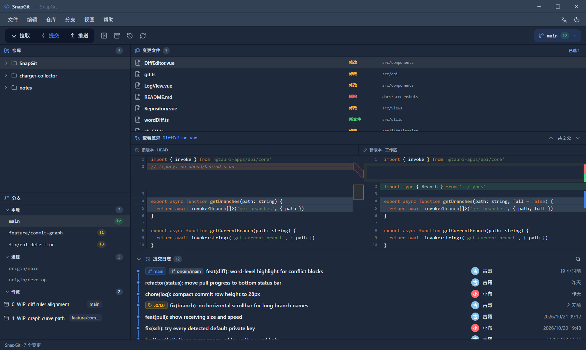

#  SnapGit

> 🚀 更轻量、更快速、更稳定的 Git 桌面客户端，基于 **Tauri 2 + Vue 3 + Rust** 构建。原生支持 Windows 与 macOS，提供浅色 / 深色主题与中英双语界面。

**[English](README.md)** · **[⬇ 下载安装包](https://github.com/gusijin/SnapGit/releases/latest)**

[](LICENSE)
[](#下载)
[](https://github.com/gusijin/SnapGit/releases/tag/v0.1.0)
[](https://github.com/gusijin/SnapGit/releases/latest)
[](https://github.com/gusijin/SnapGit)
[](LICENSE)

**💯 完全免费、开源，装好直接用，不用激活。** 不用注册账号、不用激活码 / 许可证、不用登录、没有试用期，也没有付费版和功能锁 —— 下载安装包，打开仓库就能开始用。



<sub>工作区视图：一个窗口内同时呈现仓库列表、分支、变更文件、双栏差异与提交日志。截图使用示例仓库数据。</sub>

## 下载

**0.1.0** 的四个安装包请前往 **[GitHub Releases](https://github.com/gusijin/SnapGit/releases/latest)** 下载。推送 `v*` tag 后会自动创建 Release（见下方 CI 自动打包一节）。

> ✅ 所有安装包免费下载，安装后无需注册、无需激活、没有试用期 —— 打开仓库即可开始使用。

| 平台 | 架构 | 安装包 |
| --- | --- | --- |
| Windows | x64（64 位） | [GitHub Releases](https://github.com/gusijin/SnapGit/releases/latest) |
| Windows | x86（32 位） | [GitHub Releases](https://github.com/gusijin/SnapGit/releases/latest) |
| macOS | Apple Silicon（arm64） | [GitHub Releases](https://github.com/gusijin/SnapGit/releases/latest) |
| macOS | Intel（x86_64） | [GitHub Releases](https://github.com/gusijin/SnapGit/releases/latest) |

### Windows

1. 下载 `SnapGit_0.1.0_x64-setup.exe`；**仅** 32 位 Windows 才需要 `x86` 包。
2. 运行 NSIS 安装程序，缺少 WebView2 Runtime 时会自动安装。
3. 启动后用 **文件 → 打开仓库**；首次启动也会自动扫描本机仓库，方便快速打开。

### Mac

1. 按芯片选择 DMG：Apple Silicon 用 `aarch64`，Intel 用 `x64`。
2. 打开 DMG，把 **SnapGit** 拖进 `Applications`。
3. 当前产物 **仅做 ad-hoc 签名，未经 Apple Developer ID 签名与公证**。若 Gatekeeper 提示「已损坏」，右键选择 **打开**，或移除隔离属性：

   ```bash
   sudo xattr -rd com.apple.quarantine /Applications/SnapGit.app
   ```

   分发给其他 Mac 需要 Developer ID 签名与公证，参见[开发构建](#开发构建)。

> 想自己编译？直接看[开发构建](#开发构建)。

## 界面说明

| # | 区域 | 作用 |
| --- | --- | --- |
| ① | **菜单栏与工具栏** | 文件 / 编辑 / 仓库 / 分支 / 视图 / 帮助，以及拉取、提交、推送、刷新、切换分支和 `↑N ↓N` 领先落后指示；macOS 使用系统顶部菜单栏。 |
| ② | **左侧栏** | 仓库列表（可折叠）、本地 / 远程分支及 ahead/behind 徽标、储藏列表，以及可选的子模块面板；各面板分隔条可拖拽并记住位置。 |
| ③ | **工作区** | 上方变更文件、中间双栏差异（删红增绿、语法高亮、右侧概览标尺、中间弧形连接带）、下方提交日志。 |
| ④ | **历史视图** | 带分支 / 标签标记的提交图谱、所选提交的文件列表与差异。 |
| ⑤ | **底部状态栏** | 跨视图常驻：`仓库名 · 工作区摘要`、拉取实时进度（`正在接收对象 · 34% · 1.2 MiB · 300 KiB/s`）或红色未解决冲突提醒。 |

**历史视图** —— 点击任意提交即可查看该提交涉及的文件与差异：



**深色主题** —— 通过 **视图 → 切换主题**（或工具栏图标）切换，偏好会被保存：



**子模块面板默认隐藏**。在 **视图 → 子模块** 中开启，设置会持久化，下次启动自动恢复。

## 功能特性

- **免费开源 · 免激活** —— Apache-2.0 开源协议，不注册、不激活、不试用，也没有付费版；安装后所有功能直接可用。
- **仓库管理** —— 打开、克隆、初始化、扫描本地仓库；最近仓库列表与首次扫描缓存，启动即可秒开。
- **分支管理** —— 创建、切换、重命名、合并、删除本地 / 远程分支；领先 / 落后计数；游离 HEAD 识别。
- **提交与同步** —— 暂存、提交、提交并推送、merge / rebase 策略拉取、非快进时「拉取并推送」一键恢复；推送失败分类（凭据 / SSH / 非快进），自动尝试所有检测到的 SSH 默认私钥。
- **差异查看** —— 双栏行级差异 + 语法高亮、词级改动、行尾符（EOL）不一致提示、二进制文件防护、大文件 5000 行截断；并提供可编辑的差异窗口。
- **冲突解决** —— ours / working / theirs 三栏合并编辑器（含弧形连接带）、完成合并 / 继续变基 / 放弃操作；冲突未解决时禁止提交。
- **子模块** —— 列出、添加、更新、同步、移除，展示初始化 / 指针变化 / 工作区脏状态。
- **储藏** —— 创建、应用、删除 stash。
- **体验** —— 浅色 / 深色主题、中英双语、底部状态栏、拉取实时进度、可拖拽面板、提交守卫，以及分阶段加载，保证大仓库首屏依然流畅。
- **跨平台** —— 同一份代码产出 Windows x64 / x86 与 macOS Apple Silicon / Intel（Windows 用 WebView2，macOS 用 WKWebView）。

## 开发构建

### 前置依赖

- Node.js 18+、Rust 1.70+、Git
- Windows：Visual Studio Build Tools（MSVC + WebView2）
- macOS：Xcode Command Line Tools

```bash
npm install
npm run tauri dev      # 开发模式启动
npm run build          # 仅类型检查 + 构建前端
```

### 打包

```bash
# Windows（NSIS 安装包，默认 x64）
npm run tauri -- build --bundles nsis

# Windows 32 位（首次需添加目标）
rustup target add i686-pc-windows-msvc
npm run tauri -- build --target i686-pc-windows-msvc --bundles nsis

# macOS（必须在 Mac 上构建，Apple 不允许交叉编译 macOS 应用包）
npm run tauri -- build --bundles dmg
```

产物位于 `src-tauri/target/release/bundle/`；指定 `--target` 时多一层目标三元组目录。macOS 产物默认仅做 ad-hoc 签名，对外分发需在 `tauri.conf.json` 配置 `bundle.macOS.signingIdentity` 为 Developer ID 并做公证。

### CI 自动打包

`.github/workflows/release.yml` 用三个 job（Windows x64 + x86、macOS arm64 + x86_64、汇总）产出四个安装包。推 `v*` tag 自动发布到 GitHub Release，也可在 Actions 页面手动触发：

```bash
git tag v0.1.0
git push origin v0.1.0
```

手动触发 `workflow_dispatch` 只会重新构建并把安装包保存为 Actions 构建产物，**不会创建 GitHub Release，也不会把二进制提交回仓库**；只有推 `v*` tag 才会发布到 Releases 页面。

推送 `v*` tag 后，四个安装包会作为附件上传到 GitHub Release。安装包不会保存在源码仓库中。

## 常见问题

**SnapGit 收费吗？需要激活吗？** 完全免费、开源（Apache-2.0）。不用注册账号、不用激活码、没有激活流程、没有试用期，也不存在付费版；安装后所有功能即可直接使用。

**macOS 提示「已损坏」打不开？** 产物未经 Apple 公证，按 [Mac](#mac) 一节执行 `xattr` 命令即可。

**子模块面板在哪里？** 默认隐藏，用 **视图 → 子模块** 开启；设置会保留到下次启动。

**文件内容看起来没变，为什么标为已修改？** SnapGit 拿 Git 期望的行尾格式（`core.autocrlf` / `core.eol`）比较，而不是直接对比 HEAD blob；差异面板顶部会给出 EOL 提示。

## 许可证

[Apache License 2.0](LICENSE)。
